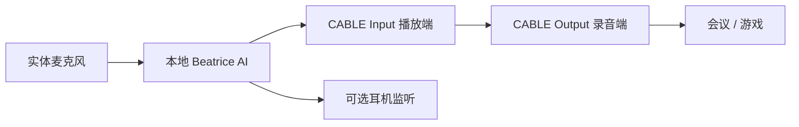

# Voice Changer · 离线 AI 变声器

**在 Windows 11 上，把麦克风男声转换为女声，再交给会议、游戏等应用。**

中文桌面界面 · 本地 AI 推理 · 官方 CPU 音色 / 自定义 GPU 音色 · 虚拟麦克风接入

[下载 Windows 预览版](https://github.com/GoesM/voice_changer/releases/tag/v0.3.0-alpha.1) · [首次使用教程](docs/user/QUICKSTART.md) · [功能介绍](docs/user/FEATURES.md) · [常见问题](docs/user/TROUBLESHOOTING.md) · [反馈问题](https://github.com/GoesM/voice_changer/issues)

> **v0.3.0-alpha.1 是实验性预览版。** 首次可在软件内启动官方 VB-CABLE 安装，并通过应用从 Beatrice 官方下载插件和模型；之后音频处理可离线运行。当前未完成腾讯会议/瓦洛兰特实机通话、自然度盲测及长时间稳定性验收，不将目标兼容当作已通过。程序暂未代码签名。

## 下载到第一次出声

1. 在 [GitHub Releases](https://github.com/GoesM/voice_changer/releases) 下载 `VoiceChanger-0.3.0-alpha.1-win-x64.zip`，完整解压后运行 `VoiceChanger.exe`。**无需安装 Python。** `Source code.zip` 是源码，不是应用程序。
2. 点击“安装虚拟麦克风”，软件下载并校验官方 VB-CABLE；完成官方安装器步骤后按提示重启。
3. 阅读模型条款并同意后，点击“下载并配置 AI”，约 58 MB。插件和模型不会被镜像到本仓库。
4. 实体麦克风选你的耳机/USB 麦克风，变声输出选 **CABLE Input**，先关闭监听。
5. 点击“开始 AI 变声”，把会议或游戏的麦克风选为 **CABLE Output**。扬声器保持正常耳机。

详细步骤：[开箱配置教程 →](docs/user/QUICKSTART.md)。首次需要驱动及模型准备，当前不是一个 EXE 内置全部依赖的零配置方案。



## 已实现的亮点

- **素材集管理**：选择、重命名和复制已有项目；素材显示名称、时长、来源，可试听和移除。
- **原创稿件引导采集**：40 段约 4,900 字，逐段录音、试听、确认和下次继续。待确认录音不参与训练；[素材与朗读教程](docs/user/MATERIALS_AND_READING.md)。
- **配套文字稿件包**：Release 提供 ReadingKit，采用 CC0；应用也已内置。文字包不包含明星录音、用户录音或模型。

- **本地音色工作室（实验性）**：分段录音、WAV 导入、试听、质量门槛、取消/重试、RVC 训练后入库；[完整教程](docs/user/CUSTOM_VOICE.md)。
- **应用内环境准备**：按需安装独立训练环境，无需用户配置 Python；训练和自定义音色推理需 NVIDIA CUDA 显卡。
- **自定义音色双模式**：游戏与会议分别使用不同分块、上下文和检索强度；效果及总延迟仍需实测。云训练尚在开发，无上传入口。

- **真实本地 AI**：标准 VST3 宿主运行 Beatrice 2，非简单升调冒充 AI；两种官方女声音色入口，支持音调/共振峰调整。
- **离线音频链路**：联网仅用于主动下载或打开教程，无云端推理、账号服务或音频上传。
- **中文首次配置**：下载 SHA-256 校验、选择已有模型、设备枚举与系统声音设置入口。
- **静音与故障处理**：无原声自动旁路；启动模型自检，有界队列丢弃过期音频，避免无限积压。
- **配置与诊断**：保存设备和音色，显示电平、处理耗时、丢块及欠载，导出不含音频的诊断文件。
- **GitHub 持续交付**：Issue 管理需求和缺陷，Actions 测试打包，版本标签触发预览版发布。

## 教程导航

| 我想… | 去哪里 |
| --- | --- |
| 下载、安装、第一次使用 | [QUICKSTART](docs/user/QUICKSTART.md) |
| 配置腾讯会议 / 瓦洛兰特 | [应用接入](docs/user/QUICKSTART.md#4-接入会议和游戏) |
| 了解功能及边界 | [FEATURES](docs/user/FEATURES.md) |
| 排查无声、卡顿、下载失败 | [TROUBLESHOOTING](docs/user/TROUBLESHOOTING.md) |
| 编译、测试、发布 | [开发指南](docs/engineering/DEVELOPMENT.md) |
| 查看实测与未测范围 | [v0.3 验证记录](docs/validation/v0.3.0-alpha.1.md) / [v0.1 基线](docs/validation/v0.1.0.md) |
| 管理素材、跟随稿件采集 | [素材库与引导朗读](docs/user/MATERIALS_AND_READING.md) |
| 录制、训练自己的音色 | [自定义音色教程](docs/user/CUSTOM_VOICE.md) |
| 产品需求及交付流程 | [PRD](docs/product/PRD.md) / [验收计划](docs/product/ACCEPTANCE.md) / [流程](docs/DELIVERY.md) |
| v0.2 需求与未完成验收 | [真实音色、自定义训练与配置向导](docs/product/PRD-v0.2.md) |
| v0.3 素材和采集范围 | [素材集与原创稿件需求](docs/product/PRD-v0.3.md) |

## 环境与限制

Windows 11 x64，需满足 [Beatrice 官方](https://prj-beatrice.com/) 的 CPU 要求。官方音色无需 CUDA 或独显；自定义音色训练及推理需要 NVIDIA CUDA，建议预留 15 GB 空间。本项目尚未给出完整验证的最低配置。固定 48 kHz、单路麦克风；蓝牙、AMD/ARM64、游戏负载需另测。暂不支持任意外部模型导入、热换参数、设备自动恢复或自研驱动。

软件只控制虚拟输出，无法阻止应用自行切回实体麦克风。音频变声离线，会议/游戏自身仍可联网发送处理后的语音。

## 开发快速启动

```powershell
py -3.12 -m venv .venv
.\.venv\Scripts\python.exe -m pip install -r requirements-build.txt
.\.venv\Scripts\python.exe launcher.py
.\scripts\build.ps1
```

## 许可证与致谢

项目采用 [GPL-3.0](LICENSE)，包含 GPL 许可的 [Spotify Pedalboard](https://github.com/spotify/pedalboard)。AI 由用户本机的 [Beatrice 官方插件](https://prj-beatrice.com/) 提供，虚拟设备使用 [VB-CABLE](https://vb-audio.com/Cable/)。插件、模型、音色及驱动适用各自条款，详见 [第三方说明](THIRD_PARTY_NOTICES.md)。
