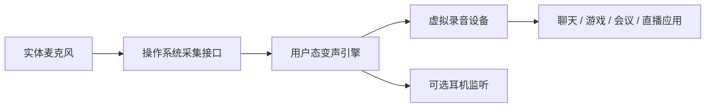

# 技术可行性评估

日期：2026-10-24。结论性质：官方资料和现有实现支持架构可行性；本项目尚无原型和性能实测。

需求更新：首发仅 Windows 11，本地 AI 男声转自然女声，优先腾讯会议和瓦洛兰特，允许下载模型，计划对外发布。用户接受首次配置系统及个别应用的虚拟麦克风，日常复用。下文跨平台和 DSP 仅作技术对比，不是首版交付范围。

## 1. 对原始设想的 review

声音应在目标应用读取之前完成处理，这一判断正确。通常无需拦截或修改每个应用，建议向系统暴露一个可选的虚拟麦克风。

目标应用最终读取的是虚拟录音端点；实体麦克风仍然存在。将虚拟设备设为默认输入只影响遵循该默认设置的应用，不能保证覆盖固定设备配置和已有音频会话。Windows 还有独立的默认通信设备角色。[S2][S3]

## 2. 可行性判断

| 目标 | 评估 | 主要约束 |
| --- | --- | --- |
| Windows 多应用接入 | 技术可行，需逐应用实测 | 虚拟设备、格式、权限、应用输入选择 |
| 轻量 DSP 变声 | 工程可行性较高 | 音质与参数设计；单纯升降调不保证自然音色 |
| 自然 AI 实时转换 | 有既有实现可供验证，产品表现待测 | 模型、硬件、前瞻/分帧、负载、音色和模型分发条件 |
| 所有应用无设置自动生效 | 不作为可保证的产品目标 | 应用可选择实体设备、独占路径或拒绝虚拟设备 |
| Windows/macOS/Linux 同时支持 | 可分别实现，不能共用一个系统驱动 | 三套端点适配、安装和系统回归 |
| 离线 AI 音频处理 | 已确定为必须满足的需求，具体模型与硬件待验证 | 允许下载模型；运行时不能依赖云端推理 |

实时 AI 项目 VCClient 提供了平台与模型实现参考，但其存在不能证明本产品达到任何特定延迟或音质。[S7]

## 3. 平台路线

Windows：使用系统音频采集接口读取实体麦克风，在用户态处理，再交给虚拟录音设备。微软 SysVAD 提供虚拟音频驱动框架示例，但不是开箱即用的音频转发产品；其部分录音/回环使用模拟信号，需补足真实传输、同步和故障处理。[S1]

macOS：按 Apple 指引评估 Audio Server Driver Plug-in。Apple 明确说明 AudioDriverKit 面向物理音频设备，虚拟设备建议采用 Audio Server Driver Plug-in；不能简单把 Windows 驱动方案迁移过去。[S5]

Linux：PipeWire filter-chain 支持构建虚拟 source 和处理图；实际支持范围还取决于发行版、音频服务和应用路径。[S6]

## 4. 虚拟设备的选型决策

| 路线 | 用途与收益 | 风险与门槛 |
| --- | --- | --- |
| 复用现有已签名虚拟音频组件 | PoC 尽快验证端到端闭环 | 安装依赖、分发许可、品牌/升级控制；不得假定免费使用等于可随产品分发 |
| 自研 Windows 虚拟驱动 | 控制端点、生命周期和安装体验 | 驱动开发、签名/认证、兼容和长期维护成本 |
| 物理设备 APO 路线 | 可用于特定设备处理扩展 | 不作为任意硬件通用接入的默认方案 |

建议先使用已核验安装和许可条件的现成组件做验证，再用 ADR 决定正式版复用、授权或自研。尚未选定供应商、语言、UI 框架、模型或推理运行时。

Windows 正式驱动发布需要遵循 Microsoft 当前签名和设备策略；不能把测试签名或关闭系统安全机制当作面向普通用户的安装方案。[S4] 这一发布工作必须进入计划，不能在 UI 完成后才补。

## 5. 关键风险及验证

- 延迟与自然度互相制约：测完整链路，不能用模型推理耗时替代用户体验。
- 游戏与推理争抢 GPU：必须在实际应用负载下测试，不以空载成绩代替。
- 采集与输出时钟偏差：验证重采样、缓冲上限和长时间漂移。
- 应用端降噪/自动增益可能损伤音色：分别测试应用默认与调整后的设置，记录必要操作。
- 进程/模型异常可能导致原声旁路：建议故障静音；虚拟端点要明确无数据时的行为。
- 蓝牙输入、独占模式、睡眠恢复可能改变设备与格式：单独列入兼容测试。
- 安装、升级、卸载会影响系统音频体验：在干净测试机验证并保留恢复步骤。

## 6. 分阶段验证与退出条件

1. 链路 PoC：实体麦克风→简单处理→虚拟输入→系统录音和一个用户目标应用；保存录音与路由证据。失败则先修正端点路线。
2. 效果 PoC：按用户效果目标选择候选 DSP/AI，实现统一语料对比；记录许可证、模型版本、硬件、清晰度、自然度和延迟。
3. 负载 PoC：连续运行与目标应用同时负载，测 p50/p95、最大值、断音、CPU/GPU/内存/显存。达不到指标时提交范围/质量/硬件取舍，不能静默放宽需求。
4. 发布 PoC：验证组件授权、正式安装路径、系统安全配置、卸载与恢复；闭环后才承诺面向外部用户交付。

每阶段产物写入后续 docs/validation/；目前均未执行。效果方向和首发系统已确定，硬件、具体模型和团队资源未锁定，暂不提供确定工期或成本。

新增验证重点：腾讯会议的远端听感与降噪影响；瓦洛兰特正常反作弊环境下的设备接入、按键说话和游戏负载下的帧率/帧时间影响。不得从虚拟麦克风被系统枚举推断两应用兼容。断网处理测试与联网会议/游戏测试分开进行，见产品验收计划。

## 7. 参考依据

以下资料于 2026-10-24 查阅；技术建议为基于资料的工程判断。

- [S1 Microsoft SysVAD sample](https://learn.microsoft.com/en-us/samples/microsoft/windows-driver-samples/sysvad-virtual-audio-device-driver-sample/)
- [S2 Default Audio Endpoint Selection](https://learn.microsoft.com/en-us/windows-hardware/drivers/audio/default-audio-endpoint-selection)
- [S3 Using a Communication Device](https://learn.microsoft.com/en-us/windows/win32/coreaudio/using-the-communication-device)
- [S4 Windows Driver Signing Policy](https://learn.microsoft.com/en-us/windows-hardware/drivers/install/kernel-mode-code-signing-policy--windows-vista-and-later-)
- [S5 Apple: Creating an audio device driver](https://developer.apple.com/documentation/audiodriverkit/creating-an-audio-device-driver)
- [S6 PipeWire Filter-Chain](https://docs.pipewire.org/page_module_filter_chain.html)
- [S7 VCClient / w-okada voice-changer](https://github.com/w-okada/voice-changer)
